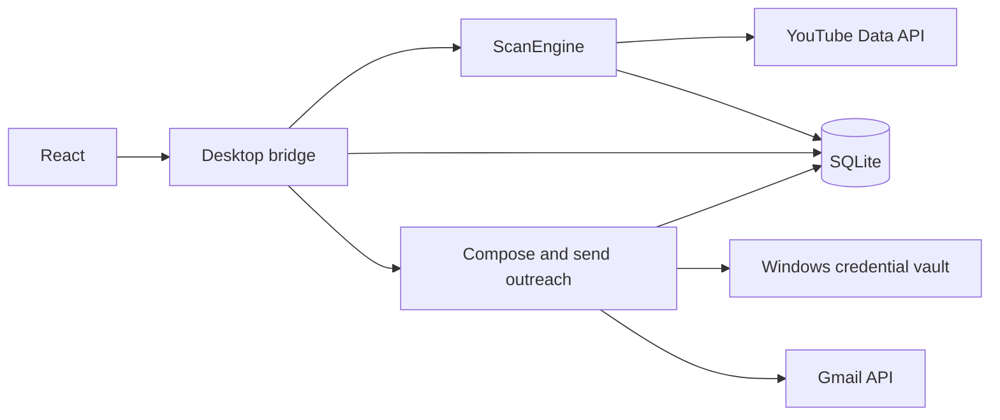

# Architecture and Source Organization

The product is a Windows application for YouTube market researchers: discover channels, screen public metrics, and organize results. Outreach is a supporting feature. The React desktop is the default experience; the CLI and CustomTkinter interface remain for compatibility. Limitations and development direction for this audience are described in the [product direction](../product/COMMERCIALIZATION.md).

## Directory map

```text
Ytb-Bot/
├── frontend/                 React, bridge types, and browser tests
│   ├── src/components/       Screens and user interactions
│   └── tests/                Playwright with a mocked bridge
├── ytb_bot/                  Application Python code
│   ├── core/                 Scanning, contacts, tables, and SQLite
│   ├── desktop/              WebView2, bridge, Gmail, and credential vault
│   ├── cli/                  Compatibility command-line scanner
│   └── legacy_ui/            Compatibility CustomTkinter interface
├── tests/                    Python tests organized by feature
├── scripts/
│   ├── checks/               Native and EXE smoke tests
│   ├── dev/                  Interface preview and screenshot tools
│   └── release/              Release selection and builds
├── packaging/                PyInstaller configuration
├── docs/
│   ├── user/                 User guides
│   ├── engineering/          Development, interface, and releases
│   ├── product/              Commercialization preparation
│   └── reviews/              Reports with dates and defined scope
├── .github/workflows/        Checks, builds, and releases
├── gui_app.py                Compatibility desktop launcher
└── bot.py                    Compatibility CLI launcher
```

Keep `README.md`, `LICENSE`, `.env.example`, dependency manifests, and launchers at the root so users, CI, and build tools can find them easily. Frontend configuration stays with the frontend.

## Processing flow



`frontend/src/api.ts` describes exchanged data; `desktop/api.py` exposes interface operations. `core/engine.py` handles background scanning, `core/storage.py` stores history, and `core/workbook.py` reads and presents tables. The sending workflow lives in `desktop/outreach.py`, Google integration in `desktop/gmail.py`, tokens in `desktop/credential_vault.py`, and drafts/send attempts in `core/outreach_store.py`.

## Rules for adding files

- Put shared scanning, filtering, and data logic in `core/`, without interface dependencies.
- Put window interaction, the bridge, and desktop integrations in `desktop/`. Keep the compatibility interface in `legacy_ui/`.
- Organize build/check scripts by purpose in `scripts/dev`, `scripts/checks`, or `scripts/release`.
- Put Python tests in `tests/test_<feature>.py` so the existing discovery command finds them all. Put React tests in `frontend/tests/`.
- User guides belong in `docs/user/`; technical and operational information belongs in `docs/engineering/`. The README introduces the product and directs readers.
- When moving files, update imports, paths relative to `__file__`, CI, tests, and documentation links in the same change.

Introduce deeper subdivisions only when several features need a distinct responsibility group. Avoid adding directory levels solely to make the source tree symmetrical.

## Data and generated files

| Category | Location | Handling |
| --- | --- | --- |
| Frontend build | `frontend/web-dist/` | Generated by Vite; do not commit |
| Frontend dependencies | `frontend/node_modules/` | Generated by `npm ci`; do not commit |
| Distribution | `dist/` | EXE, checksum, and metadata; do not commit |
| Build intermediates | `.release-build/`, `build/` | Do not commit |
| Check results | `artifacts/`, `frontend/test-results/`, `frontend/playwright-report/` | Do not commit |
| User data | `%LOCALAPPDATA%/Ytb-Bot/data/` | Keep outside source control |
| Local configuration | `.env`, `studio-settings.json` beside the EXE or at the source root | Do not commit |

Files such as `keywords.xlsx` may belong to the older CLI workflow. Do not automatically move or delete them during cleanup; check who uses them and back them up first.

## Display language

The main React desktop offers English (`en`), Vietnamese (`vi`), and Simplified Chinese (`zh-CN`). A display-language preference is retained in local storage and native preferences. Switching updates interface text, native prompts, and application-authored messages without reloading the window or replacing editor state. User keywords, channel data, and drafts are preserved as entered. Canonical result column identifiers and API field keys remain English; CLI and legacy interface text remain English.

## Historical data compatibility

Historical result column labels are normalized to English when read through `core/result_schema.py`. Stored rows and user-authored keywords, channel names, and drafts are not rewritten. `tests/test_result_schema.py` verifies legacy and mixed-language fields.
