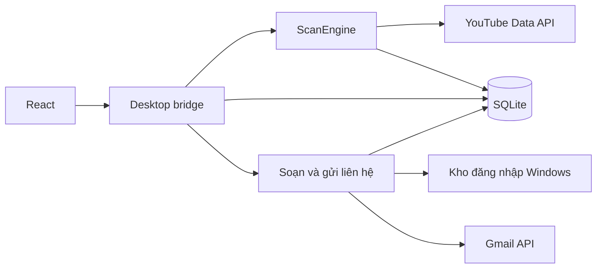

# Kiến trúc và tổ chức mã nguồn

Mục tiêu sản phẩm là một ứng dụng Windows phục vụ người nghiên cứu thị trường YouTube: khám phá kênh, sàng lọc chỉ số công khai và tổ chức kết quả. Liên hệ là chức năng hỗ trợ. Desktop React là trải nghiệm mặc định. CLI và CustomTkinter phục vụ tương thích. Các giới hạn và hướng phát triển cho nhóm khách hàng này nằm trong [định hướng sản phẩm](../product/COMMERCIALIZATION.md).

## Bản đồ thư mục

```text
Ytb-Bot/
├── frontend/                 React, bridge types và test trình duyệt
│   ├── src/components/       Màn hình và tương tác người dùng
│   └── tests/                Playwright với bridge giả lập
├── ytb_bot/                  Mã Python chạy trong ứng dụng
│   ├── core/                 Quét, liên hệ, bảng dữ liệu và SQLite
│   ├── desktop/              WebView2, bridge, Gmail và kho đăng nhập
│   ├── cli/                  Scanner dòng lệnh tương thích
│   └── legacy_ui/            Giao diện CustomTkinter tương thích
├── tests/                    Kiểm thử Python theo chức năng
├── scripts/
│   ├── checks/               Smoke test native và EXE
│   ├── dev/                  Công cụ xem/chụp giao diện
│   └── release/              Chọn bản phát hành và build
├── packaging/                Cấu hình PyInstaller
├── docs/
│   ├── user/                 Hướng dẫn người sử dụng
│   ├── engineering/          Phát triển, giao diện và phát hành
│   ├── product/              Chuẩn bị thương mại hóa
│   └── reviews/              Báo cáo có ngày và phạm vi
├── .github/workflows/        Kiểm tra, build và phát hành
├── gui_app.py                Launcher desktop tương thích
└── bot.py                    Launcher CLI tương thích
```

Giữ `README.md`, `LICENSE`, `.env.example`, manifest dependency và launcher ở gốc để người dùng, CI và công cụ build dễ tìm. Cấu hình frontend nằm cùng frontend.

## Luồng xử lý



`frontend/src/api.ts` mô tả dữ liệu trao đổi; `desktop/api.py` cung cấp thao tác cho giao diện. `core/engine.py` xử lý quét nền, `core/storage.py` giữ lịch sử, `core/workbook.py` đọc và trình bày bảng. Luồng gửi nằm trong `desktop/outreach.py`, tích hợp Google tại `desktop/gmail.py`, token trong `desktop/credential_vault.py` và bản nháp/lần gửi trong `core/outreach_store.py`.

## Quy tắc bổ sung file

- Logic quét, lọc và dữ liệu dùng chung đặt trong `core/`; không phụ thuộc giao diện.
- Tương tác cửa sổ, bridge và tích hợp desktop đặt trong `desktop/`. Giao diện tương thích giữ trong `legacy_ui/`.
- Script chỉ phục vụ xây dựng/kiểm tra đặt theo mục đích trong `scripts/dev`, `scripts/checks` hoặc `scripts/release`.
- Test Python đặt tại `tests/test_<chức_năng>.py` để lệnh discovery hiện tại nhận đủ các bài. Test React đặt tại `frontend/tests/`.
- Hướng dẫn người dùng thuộc `docs/user/`; thông tin kỹ thuật và vận hành thuộc `docs/engineering/`. README giới thiệu sản phẩm và dẫn đường.
- Khi chuyển file, cập nhật imports, đường dẫn tính từ `__file__`, CI, test và liên kết tài liệu trong cùng thay đổi.

Chỉ tách sâu hơn khi có nhiều chức năng cần một nhóm trách nhiệm riêng; tránh thêm tầng thư mục chỉ để làm cây mã nguồn cân đối.

## Dữ liệu và file sinh tự động

| Nhóm | Vị trí | Quản lý |
| --- | --- | --- |
| Build frontend | `frontend/web-dist/` | Sinh từ Vite, không commit |
| Dependency frontend | `frontend/node_modules/` | Sinh từ `npm ci`, không commit |
| Bản phân phối | `dist/` | EXE, checksum và metadata; không commit |
| Trung gian build | `.release-build/`, `build/` | Không commit |
| Kết quả kiểm tra | `artifacts/`, `frontend/test-results/`, `frontend/playwright-report/` | Không commit |
| Dữ liệu người dùng | `%LOCALAPPDATA%/Ytb-Bot/data/` | Giữ ngoài mã nguồn |
| Cấu hình cục bộ | `.env`, `studio-settings.json` cạnh EXE hoặc tại gốc source | Không commit |

Các file như `keywords.xlsx` có thể thuộc luồng CLI cũ. Không di chuyển hoặc xóa tự động khi dọn mã nguồn; kiểm tra người đang sử dụng và sao lưu trước.
