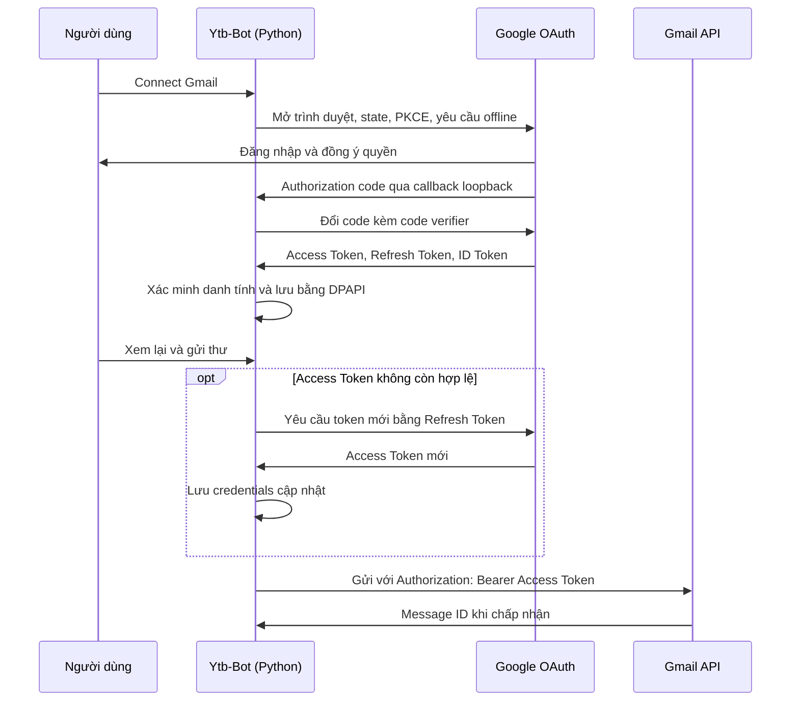

# Cách dùng Google OAuth 2.0 trong Ytb-Bot

Ytb-Bot dùng OAuth để kết nối **tài khoản gửi Gmail/Google Workspace**. Tìm kênh YouTube công khai vẫn dùng `YOUTUBE_API_KEY`. Không cần tự lấy hay dán Access Token/Refresh Token vào ứng dụng.

## 1. Chuẩn bị trên Google Cloud

1. Mở [Google Cloud Console](https://console.cloud.google.com/), tạo hoặc chọn một project.
2. Trong **APIs & Services → Library**, tìm **Gmail API** và chọn **Enable**.
3. Mở **Google Auth Platform**. Trong **Branding**, điền tên ứng dụng, email hỗ trợ và email liên hệ.
4. Trong **Audience**, chọn đối tượng phù hợp. Với tài khoản Gmail cá nhân, dùng **External**. Khi đang **Testing**, thêm chính email sẽ gửi thư vào **Test users**. Chỉ chọn Internal nếu project thuộc tổ chức Google Workspace và người dùng nằm trong tổ chức đó.
5. Trong **Data Access**, thêm các quyền sau:

   | Scope | Công dụng |
   | --- | --- |
   | `openid` | Xác minh danh tính qua OpenID Connect |
   | `https://www.googleapis.com/auth/userinfo.email` | Xác định email tài khoản gửi |
   | `https://www.googleapis.com/auth/gmail.send` | Gửi thư thay mặt tài khoản đã đồng ý |

6. Trong **Clients → Create client**, chọn loại **Desktop app**, đặt tên rồi tạo client.
7. Tải file JSON của client về máy. File hợp lệ có khóa ngoài cùng `installed`, chứa `client_id` và `client_secret`. Ứng dụng kiểm tra loại file khi nhập.

Luồng này mở trình duyệt hệ thống và nhận callback tại `http://127.0.0.1:<cổng-ngẫu-nhiên>/`. Không cần dựng máy chủ public hay nhập mã xác thực thủ công. Dùng client loại Desktop app để hỗ trợ callback loopback. Google khuyến nghị PKCE cho ứng dụng desktop; bot bật tính năng này qua thư viện chính thức.

Nguồn: [Gmail Python quickstart](https://developers.google.com/workspace/gmail/api/quickstart/python), [OAuth cho desktop](https://developers.google.com/identity/protocols/oauth2/native-app).

## 2. Kết nối trong ứng dụng

Nếu chạy từ mã nguồn đã cài dependencies và build frontend, mở ứng dụng bằng:

```powershell
python gui_app.py
```

1. Mở **Grouped contacts / Liên hệ đã nhóm** và bung **Linked accounts / Tài khoản đã liên kết**.
2. Chọn **Import Google OAuth file / Nhập tệp Google OAuth**, chọn file JSON vừa tải.
3. Chọn **Connect Gmail / Kết nối Gmail**.
4. Trong trình duyệt, chọn đúng tài khoản đã thêm vào Test users và đồng ý cấp quyền gửi Gmail. Hoàn thành trong ba phút; nếu hết thời gian thì kết nối lại.
5. Khi trình duyệt báo `YTB-BOT: Google response received.`, quay lại bot và chờ email xuất hiện trong danh sách. Đây mới là dấu hiệu bot đã đổi mã lấy token, xác minh danh tính và lưu tài khoản thành công. Bản cũ có thể hiện `YTB-BOT: Connected. You can close this tab.` ngay khi nhận callback, trước khi hoàn tất các bước này.

Bạn cũng có thể nhập cấu hình và kết nối từ phần Gmail trong cửa sổ **Compose contact**. Có thể kết nối nhiều tài khoản gửi.

File OAuth JSON là cấu hình ứng dụng; đăng nhập Google mới cấp quyền truy cập tài khoản. Không cần nhập mật khẩu Google vào bot.

## 3. Gửi thư và duy trì quyền truy cập

Chọn liên hệ email đã lưu, chọn tài khoản gửi, soạn nội dung và xem lại trước khi bấm gửi. Với lần thử thực tế đầu tiên, chỉ dùng địa chỉ nhận do bạn kiểm soát. Bot không tự gửi thư khi đăng nhập hoặc quét kênh.



- **Access Token** có thời hạn do Google trả về; bot dùng thời điểm hết hạn do thư viện lưu, không đặt lịch cố định một giờ.
- **Refresh Token** giúp xin Access Token mới mà không mở lại trình duyệt khi còn hợp lệ. Bot làm mới khi cần gửi thư, không chạy tác vụ nền chỉ để giữ phiên.
- **ID Token** dùng để xác minh email khi kết nối, không dùng làm Bearer token gửi Gmail.
- Google có thể không trả Refresh Token mới khi refresh. Thư viện giữ Refresh Token hiện có và bot lưu lại credentials cập nhật.
- Khi đóng rồi mở lại bot, credentials đã lưu được dùng lại. Không phải đăng nhập mỗi lần khởi động.

**Refresh Token không bảo đảm tồn tại vĩnh viễn.** Với ứng dụng External ở trạng thái Testing có quyền Gmail, Google quy định Refresh Token hết hạn sau 7 ngày. Khi dùng lâu dài, cần chuyển Publishing status sang Production và hoàn tất yêu cầu xác minh/chính sách nếu áp dụng. Chuyển Production không tự động đồng nghĩa đã được Google xác minh. Người dùng thu hồi quyền, đổi mật khẩu khi token có Gmail scopes hoặc chính sách quản trị cũng có thể khiến token mất hiệu lực.

Nguồn: [Vòng đời token của Google](https://developers.google.com/identity/protocols/oauth2#expiration), [thư viện OAuth Python](https://googleapis.dev/python/google-auth-oauthlib/latest/reference/google_auth_oauthlib.flow.html).

## 4. Lưu trữ và ngắt kết nối

Cấu hình và token nằm tại `%LOCALAPPDATA%\Ytb-Bot\data\mail\credentials.bin`, được mã hóa bằng Windows DPAPI cho tài khoản Windows hiện tại. Frontend chỉ nhận ID và email; không nhận token. Không chép token vào `.env`, SQLite hoặc mã nguồn. File vault không phải bản sao lưu có thể chuyển tùy ý sang máy hoặc tài khoản Windows khác.

**Disconnect / Remove account from the bot** xóa credentials của tài khoản khỏi bot. Để thu hồi quyền tại Google, mở [Google account connections](https://myaccount.google.com/connections) và xóa quyền của ứng dụng. Muốn dùng tiếp sau khi thu hồi, chọn Connect Gmail và cấp quyền lại.

## 5. Xử lý lỗi

| Hiện tượng | Cách xử lý |
| --- | --- |
| Bot từ chối file JSON | Tạo client loại Desktop app và nhập file tải từ Google có khóa `installed`. |
| `access_denied` hoặc tài khoản thử nghiệm bị chặn | Thêm đúng email vào Audience → Test users; kiểm tra hạn chế của quản trị viên Workspace nếu có. |
| `redirect_uri_mismatch` | Kiểm tra đã chọn Desktop app; tải lại JSON đúng project và nhập lại. |
| Đăng nhập xong nhưng bot chưa kết nối | Kiểm tra trang callback local có mở được không; hoàn thành trong ba phút rồi thử lại. |
| Trình duyệt đã báo nhận phản hồi nhưng bot vẫn đang kết nối | Bot còn phải đổi code lấy token và xác minh email qua mạng. Bản cập nhật đặt timeout 30 giây cho mỗi yêu cầu ở hai bước này; nếu lỗi, bot trở về trạng thái cho phép kết nối lại. Nếu đang chạy EXE cũ, cần bản build mới để nhận sửa đổi. |
| Bot vẫn hiện “Đang kết nối…” dù tài khoản đã lưu | Bản cũ có lỗi bộ đếm kiểm tra trạng thái bị khởi động lại mỗi lần trang cha render. Bản cập nhật giữ callback ổn định để email tự xuất hiện sau khi kết nối xong. Với bản cũ, đóng rồi mở lại mục Tài khoản đã liên kết để tải lại danh sách. |
| Không lấy được quyền offline | Kết nối lại và đồng ý các quyền yêu cầu. Bot chỉ lưu tài khoản khi có Refresh Token và email được xác minh. |
| `Unable to refresh sign-in. Reconnect the Gmail account.` | Kiểm tra mạng; nếu quyền đã hết hạn hoặc bị thu hồi, kết nối lại Gmail. Bot không gửi thư khi bước refresh lỗi. |
| Mỗi tuần cần kết nối lại | Kiểm tra External/Testing và thời hạn 7 ngày; đọc điều kiện Production/xác minh ở trên. |
| Gmail từ chối gửi | Kiểm tra Gmail API đã bật trong project tạo client, quyền `gmail.send` và chính sách tài khoản. |
| Không rõ thư đã được gửi chưa | Kiểm tra Sent trong Gmail trước khi gửi lại. Bot không tự retry yêu cầu gửi có kết quả không rõ. |

## 6. Mã nguồn và kiểm chứng

| Thành phần | Vị trí |
| --- | --- |
| Nhập client, đăng nhập PKCE, xác minh danh tính, refresh và Bearer request | `ytb_bot/desktop/gmail.py` |
| Kết nối nền, lưu tài khoản, ghi token mới trước khi gửi | `ytb_bot/desktop/outreach.py` |
| Mã hóa và giao dịch cập nhật credentials | `ytb_bot/desktop/credential_vault.py` |
| Giao diện liên kết tài khoản | `frontend/src/components/LinkedAccounts.tsx` |
| Kiểm thử OAuth và gửi thư | `tests/test_outreach.py` |

```powershell
python -m unittest discover -s tests -p test_outreach.py -v
```

Kiểm thử giả lập phản hồi Google nhưng dùng đối tượng credentials và logic refresh của thư viện thật; kiểm thử DPAPI dùng cơ chế mã hóa Windows thật. Các kiểm thử này không chứng minh đăng nhập Google thực tế hay gửi thư thành công. Kiểm chứng trực tiếp cần OAuth client của bạn, tài khoản đã cấp quyền và hộp thư thử nghiệm bạn kiểm soát.
